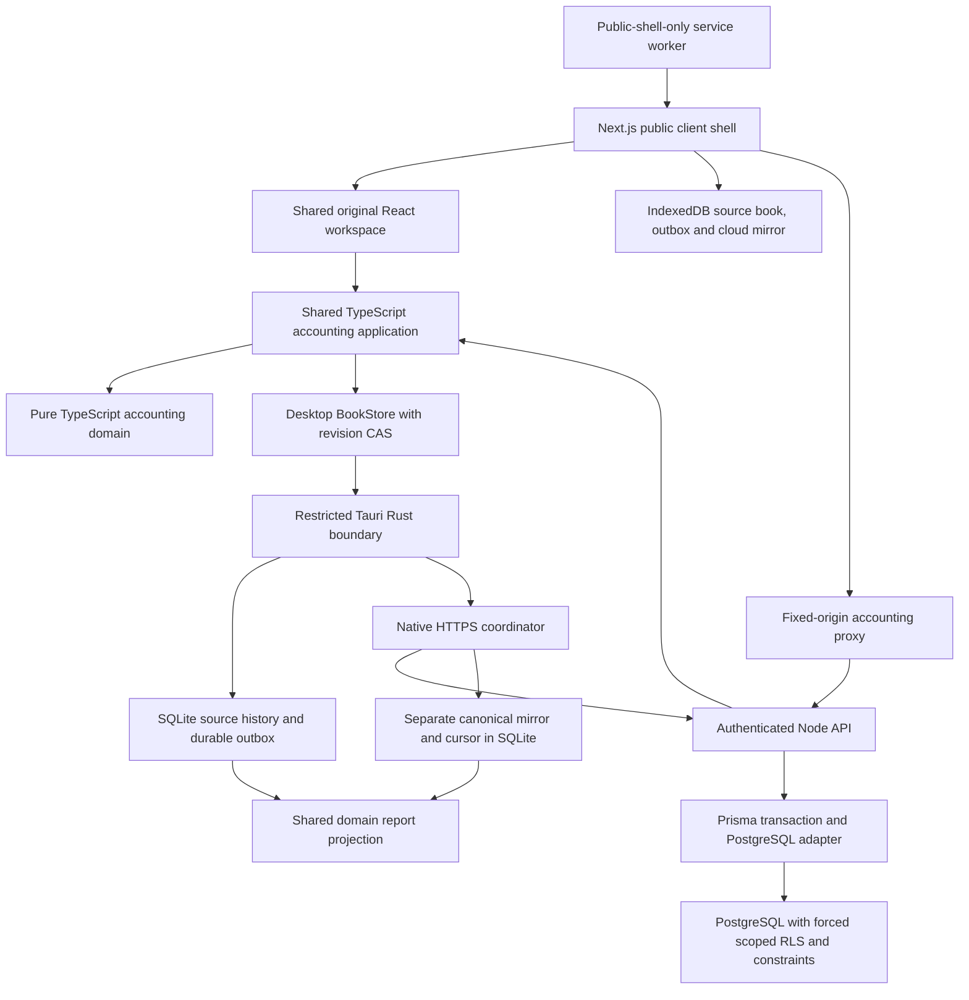

# Architecture overview

Status: Phases 1–4 approved/closed. Phase 5 browser implementation is undergoing verification; [phase status](../progress/phase-status.md) records actual checks and approvals. Invoicing, inventory and release deployment have not begun.

## Implemented topology

Vite embeds static React assets in Tauri. The installed desktop contains no Node server. The separate Node service uses native HTTP/HTTPS, crypto and bounded Zod contracts; no web framework, queue service, Redis or microservices were added.

## Workspace responsibilities

| Path | Implemented responsibility |
| --- | --- |
| `packages/domain` | Exact bigint money, real dates, scoped chart, journal/reversal rules and reports; no framework, database or I/O dependencies |
| `packages/application` | Trusted-principal authorization, versioned/idempotent commands, unit-of-work ports and shared immutable commit guards |
| `packages/contracts` | Protocol-1 schemas, role permissions and strict external snapshot validation; a separate small codec/report projection avoids bundling Zod into the desktop |
| `packages/workspace` | Existing React forms/styles/error controls, host contract, shared CAS BookStore and report projection; injected host I/O, no database/runtime dependency |
| `apps/desktop` | Tauri host, local password vault, SQLite transactions, encrypted backups, native-only cloud sessions and sync |
| `apps/web` | Next.js static public shell, fixed-origin API proxy, native IndexedDB/Web Crypto/Cache APIs, browser sessions/grants, sync and external backups |
| `apps/api` | Scrypt authentication, company membership checks, Prisma/PostgreSQL transactional posting, security administration, grants and change feed |
| `tools` | Scoped development database, native build/test helpers, WebView2 tests, audits and recovery-epoch operation |

Existing Field/Panel/forms/styles and the CAS adapter were extracted into the populated workspace package; desktop and browser use the same implementation. Vite/domain/application validation and tests were reused. No state-management, IndexedDB wrapper, PWA framework or extra cryptography dependency was introduced. Next.js is the sole new runtime framework in Phase 5.

## Authority and transactions

A local tenant/vault is independent of a cloud organization. Explicit owner-reviewed enrollment imports a fixed historical snapshot; joining creates a separate local source book with cloud masters and a canonical mirror. Local journal scope, actor, timestamps, receipts and audit never change to impersonate server records.

The renderer runs shared accounting use cases, but native storage checks scope, immutable transitions, current offline permissions and typed command/result consistency before a SQLite commit. New financial receipts, audit, journal and outbox are atomic. Revision CAS handles competing windows/processes.

The service derives identity from an opaque session, authorizes current membership/company access, locks the company, reruns the same accounting service and atomically writes its outcome, accepted journal/audit and company change cursor. Posted transactions use no last-write-wins merge. The runtime database role cannot own tables or bypass RLS; transaction-local context is reset under pooling.

Native synchronization plans durable work under short locks, releases the vault/file/SQLite locks for HTTPS, then revalidates identity/generation and applies acknowledgments or a canonical snapshot atomically. Shared master changes are online-only after enrollment. Operational reports combine the accepted cloud mirror with this device's eligible pending entries, deduplicating IDs; canonical-only and original-device views remain explicit.

## Limits and later work

Carried-forward targets remain provisional, not waived by this phase's small synthetic samples:

| Concern | Target on an agreed representative device/dataset | Later proof |
| --- | --- | --- |
| Desktop start | Usable local company within 3 seconds on SSD/4 GB RAM | Phase 3/4 baseline; Phase 9 release dataset |
| Local posting | p95 under 200 ms for 20 lines, excluding user input | Phase 3 baseline; Phase 9 scale |
| Trial balance | Under 2 seconds for 100,000 posted lines | Phase 9 representative dataset |
| Idle memory | Under 200 MiB including descendant WebView processes | Phase 3/4 samples; Phase 9 refinement |
| Accessibility | Complete keyboard entry, focus/labels/error recovery; WCAG 2.2 AA target | Current automated associations; later broader audit |
| Accounting | No unbalanced, duplicate or silently mutated postings; reproducible totals | Continuous engine/adapter/sync checks |

Current snapshots/validation copy whole small-company books: 16 MiB financial/request limits, an 18 MiB native response cap and 128 MiB local backup limit bound memory. Change cursors are incremental, while each returned batch contains one complete as-of snapshot. Large-book storage/feed redesign requires measurements in Phase 9.

Native cloud transport requires HTTPS except loopback development, blocks redirects and has bounded timeouts. Sign-out/lock clears native bearer memory; signed public offline grants last at most 24 hours. Windows account/disk protection remains necessary because SQLite is unencrypted. OS administrators can modify executables/files or clocks; immediate disconnected revocation cannot be guaranteed.

The Next.js `/` route prerenders only a public loading shell; financial data and passwords never enter server rendering, RSC props or public caches. React opens the origin's local vault after hydration. The service worker precaches only `/`, manifest/icon and build-hashed static assets. Offline reopening requires an initial successful install. Normal worker waiting keeps old clients on their existing shell until every workspace tab closes; database version changes close stale connections and require reload. No automatic financial reset, forced worker takeover or background posting service exists.

IndexedDB write acknowledgment follows transaction completion, requesting strict durability where supported; browser/OS eviction and physical-disk guarantees differ from native SQLite. Browser credentials, backup KDF and threat limits are documented in [security](security.md). Packaging/signing, clean-machine installation, production hosting, realistic scale, RPO/RTO and comprehensive adversarial assurance remain Phases 9–10, separately approved. Current synthetic resource samples describe this host only.
