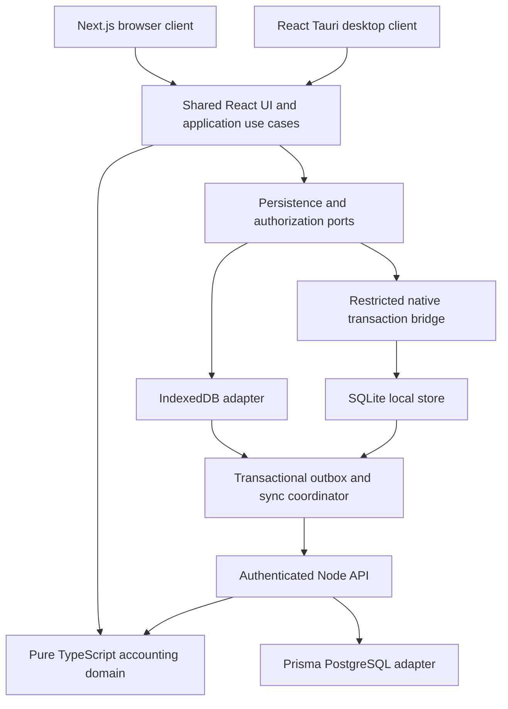

# Architecture overview

Status: Phase 1 approved/closed; Phase 2 domain/application engine implemented and awaiting closure approval. `packages/domain` contains pure TypeScript rules/projections; `packages/application` contains authorization orchestration, transactional contracts and an explicitly in-memory reference adapter. Tests/build/type/lint and emitted-package integration pass. No native/web UI, database, sync service or authentication exists. The wider topology below remains proposed. See [research provenance](../research/tally-workflows.md).

## Product boundaries

Build an original offline accounting product with Windows desktop and browser clients, a shared accounting model, optional secure cloud synchronization, multiple companies/years and eventual SaaS deployment. Desktop must post without internet or a Node server. Browser offline use requires an initial successful installation/load and compatible persistent storage; it cannot promise desktop-level durability.

Tenant identifies the customer organization; companies hold separate books. A local-only organization exists without a cloud account. Its future cloud enrollment is an explicit reconciliation/import process, not an automatic change of authority. Initially support one base currency per company; future FX posting requires separately approved valuation/rounding rules.

## Proposed topology

The diagram describes planned responsibilities, not deployed services. One modular cloud backend is sufficient; no microservices, Redis, queue broker or always-running desktop background service is justified yet.

## Workspace plan

`packages/domain` and `packages/application` now exist as npm workspaces; all other paths below are future-phase plans. Root scripts run real Vitest/type/lint/build/repository checks. Domain has no external runtime dependencies; application depends only on the domain workspace and uses the standard structuredClone API (DOM typings for the shared API, not a browser framework). No UI/native/cloud stack installed.

| Planned path | Earliest phase | Responsibility / forbidden coupling |
| --- | --- | --- |
| `packages/domain` | 2 | Exact money and accounting rules; no React/SQL/Prisma/Zod/runtime I/O imports |
| `packages/application` | 2 | Commands, authorization policy orchestration, unit-of-work ports; depends on domain, not concrete storage |
| `packages/contracts` | 4 if needed | Versioned external command/ack/change schemas and serialization; domain errors mapped at boundary |
| `apps/desktop` | 3 | React host, Rust native IPC/SQLite adapter, window lifecycle; no unrestricted renderer SQL/filesystem |
| `packages/ui` | 3, extracted as reuse warrants | Original reusable forms, navigation, status and keyboard behavior; no accounting arithmetic |
| `apps/api` | 4 | Node authentication, server command execution, PostgreSQL adapter, incremental feed; Prisma stays server-side |
| `apps/web` | 5 | Next.js hosting/client routes, IndexedDB adapter, service worker; no DB credentials or offline reliance on server actions |

Adapter code stays with its host until reuse justifies a separate package. Avoid empty packages, universal repositories and one-to-one wrappers around native APIs. npm workspaces orchestrate actual packages; reconsider Turborepo only after measured task/build bottlenecks.

## Runtime and transaction boundaries

The same TS domain validates commands on desktop, browser and server. Application code reads a consistent company/period snapshot, validates it, and commits through an adapter that checks expected versions and permissions again within the transaction. A validation result is not a durable posting acknowledgment.

Tauri needs native Rust for narrow OS/SQLite operations; TypeScript alone cannot be its privileged host. The renderer is untrusted. A bounded native command accepts a typed posting plan, validates shape/scope, and atomically persists the plan, receipt, audit event and outbox. SQL/native enforcement of balance, references, locks and immutability is defense in depth, not a second implementation of pricing/tax/valuation algorithms. Browser checks protect consistency but cannot defeat a user controlling their browser. The server always reruns shared domain validation with current authorization and trusted state.

Next.js server rendering, server actions and route handlers are not desktop runtime dependencies. Tauri's Next.js guidance requires static exports; the proposed desktop uses a small standalone React bundle instead. Shared components must avoid Next-specific APIs. This choice trades one small host build for no embedded Node server. [Tauri Next.js guidance](https://v2.tauri.app/start/frontend/nextjs/)

## Nonfunctional targets for review

These are provisional targets, not measurements or release guarantees. Select representative low-end Windows hardware, dataset and browser matrix before implementing benchmarks.

| Concern | Proposed acceptance target | Measurement phase |
| --- | --- | --- |
| Desktop start | Usable local company within 3 seconds on agreed SSD device, 4 GB RAM | 3 baseline; 9 release dataset |
| Local posting | p95 under 200 ms for 20 lines excluding user input, with durable acknowledgment | 3 and 9 |
| Trial balance | Under 2 seconds for 100,000 posted lines on agreed device | 3 and 9 |
| Idle memory | Desktop under 200 MiB private working set including its WebView processes | 3 baseline; 9 refinement |
| Accessibility | Keyboard-complete core entry, visible focus, meaningful labels and predictable error recovery; target WCAG 2.2 AA | 3 onward |
| Financial correctness | No unbalanced, duplicated or silently mutated posted journals; totals reproducible from source entries | 2 onward |
| Recovery | Zero acknowledged-local-post loss in tested process-crash scenarios; hardware durability bounded by OS/device behavior | 3 onward |

RPO/RTO, cloud region and availability objectives require owner approval; see [risk register](decisions.md). Browser quota and eviction remain user-agent policies even when persistence is requested. [MDN storage limits](https://developer.mozilla.org/en-US/docs/Web/API/Storage_API/Storage_quotas_and_eviction_criteria)

Dependency admission and security boundaries are specified in [decisions](decisions.md) and [security](security.md). Planned testing is in [test strategy](../testing/test-strategy.md). None of these requirements has yet been validated by an application build.
